# A7 – FEA Iterative Process

## Assignment Objective

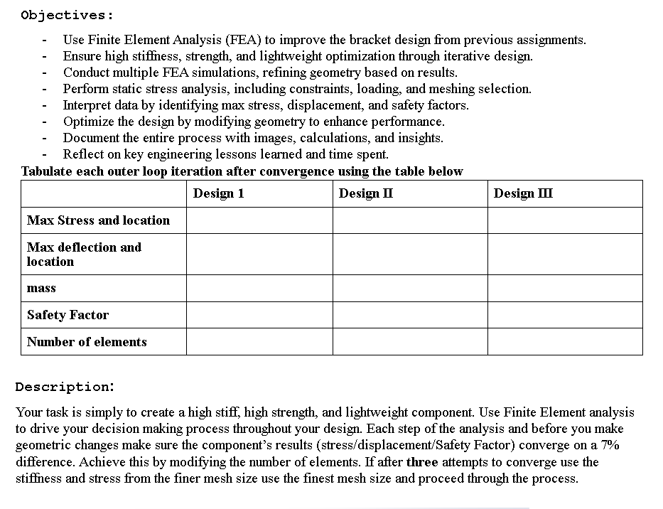

Below is the final model of the part after three iterations of FEA. The model has been marked for easy identification of features throughout the assignment. When a feature is referenced, it will be with regards to the image below. 

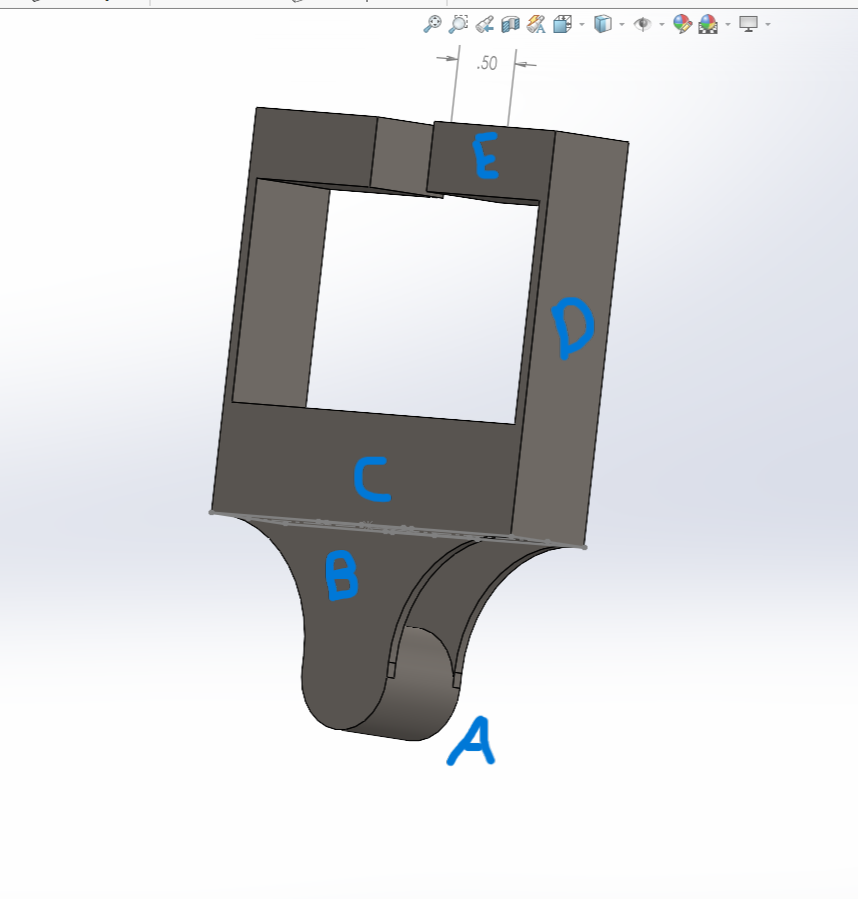

## Overall Study Information

Below is information that pertains to all iterations of the FEA

Fixtures-
The part is constrained by a fixed connection at feature E as shown below

.jpg)

Load-
The load is 1000 pounds of force distributed across feature A uniformly, as shown above.

Calculations-
The calculations for convergence were all solved using excel to eliminate human error. The equation as provided by the lecture powerpoint can be seen below.

 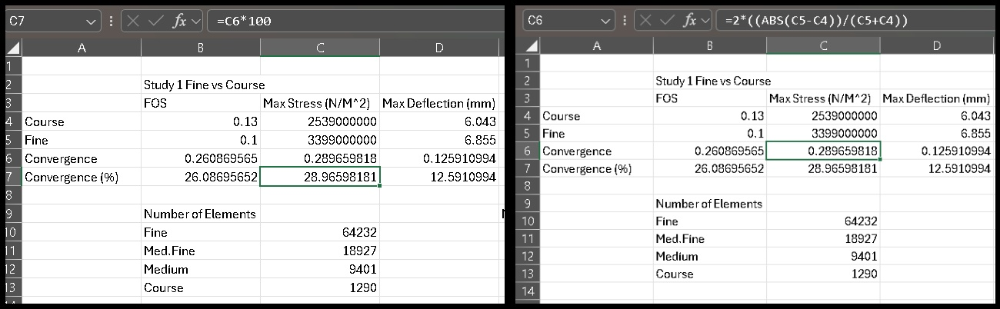

## Study 1 (Original Design Testing)

Once constraints and loads were set, I began by creating a course mesh and running the study. I proceeded to create more mesh sizes with varying element counts and checking the convergence. I completed multiple convergence tests between the mesh sizes. After conducting three convergence testing cycles the final data was from the fine mesh with 64,232 elements. The convergence tests and the results of the multiple mesh tests are available below. The fine mesh data is highlighted green. The required 7% convergence was not met on all perameters.

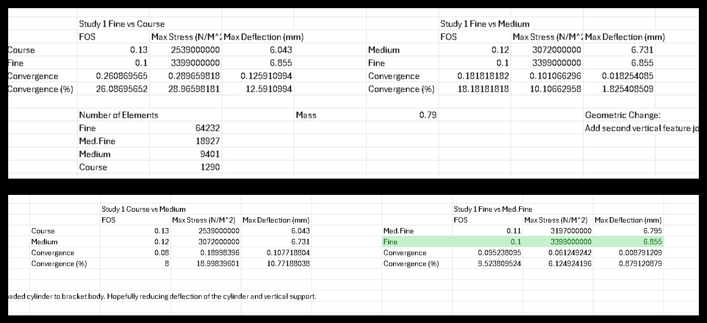

.jpg)

.jpg)

.jpg)

The image below shows the point of maximum stress and deflection on study 1. These locations are the subject of future design changes for study 2 to improve the part.

.jpg)

After completing the first study it was apparent that the original formulas used to create the part were not sufficient when tested. The bending occurring at feature B would have to be addressed to work toward the required safety factor and max deflection. 

## Study 2 (Second Vertical Support Added)

Study 2 Geometric Changes- The major failure of the part during study 1 was the deflection of feature A. In order to minimize deflection, I am adding another support opposite of feature B that will make feature A behave more like a beam fixed at both ends as opposed to a cantilever beam. This will lower the bending of feature B which was the location of maximum stress. The same meshing process as before was used here. Beginning with a course mesh and creating more meshes from there and testing for convergence. Ultimately, the final data values used were from the medium course mesh with 2,949 elements after running three convergence test cycles. The required 7% convergence was not met on all perameters.

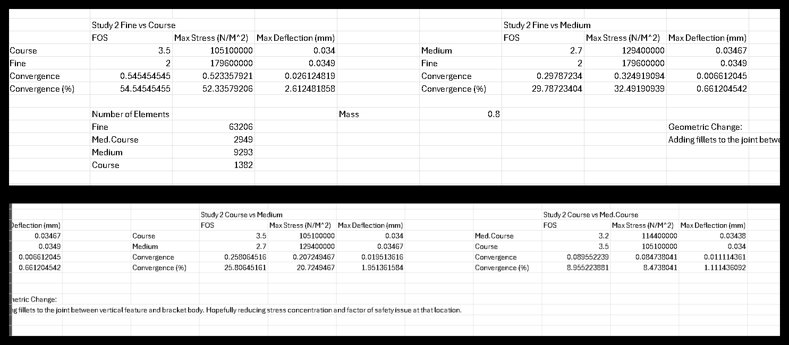
.jpg)
.jpg)
.jpg)
.jpg)
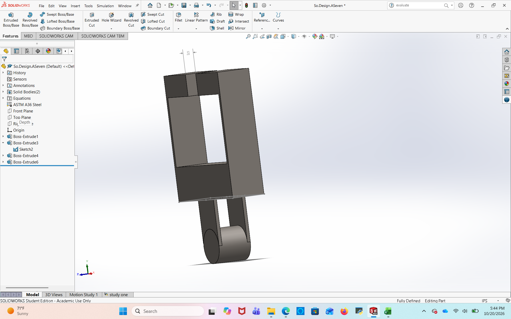

## Study 3 (Fillet Added)

Study 3 Geometric Changes- The failure point in study 2 was the joint between feature B and feature C. Particularly in the outer most edges. To combat this, I am adding a fillet at those joints. I made radius changes to the fillet after beginning study 3 when I realized that a large radius would be required to lower stresses and increase the safety factor. Mesh process was the same as the prior studies. Starting with a course mesh and creating other mesh configurations to find convergence. The final data used was from the medium course mesh with 2,723 elements. The required 7% convergence was not met on all perameters.
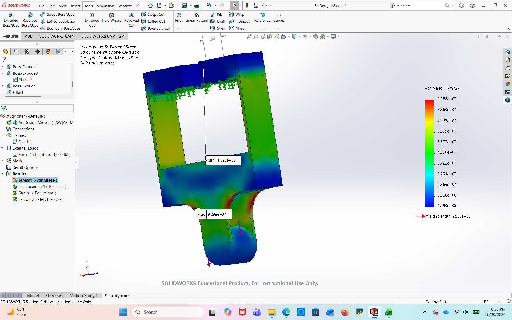
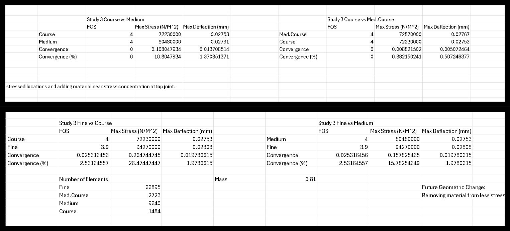

Below are the results from study three. These are taken from the enlarged fillet model. They show improvements in the failure points of study two but also show where improvements can still be made. If further iterations are completed, these stress and deflection maximums are where I would target improvements. 

.jpg)
.jpg)
.jpg)
.jpg)

## Results 

Below are the results from the three FEA iterations. Throughout the process, the values shown in the table have all been minimized/maximized to meet the original criteria of the bracket design. 

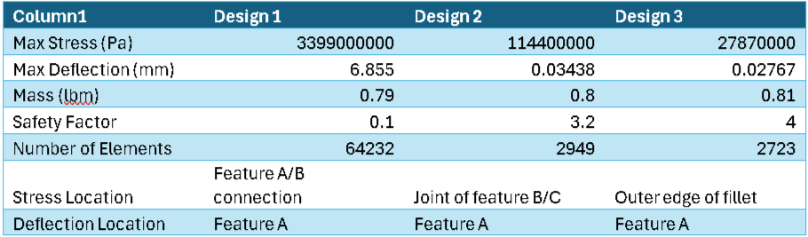

## Lessons Learned

After completing FEA cycle one I learned that using simple calculations for member dimensions doesn't always tell the whole story. Simulations are required to test design theory to ensure that your assumptions are correct. After completing the first iteration I changed the model to add an additional feature B. This gave me trouble as the feature appeared to be identical to feature B but did not attach in the same manner. This can be seen in the model shown in study 2. This gave errors when conducting the study as Feature A still bent like a cantilever beam away from the additional support that was added instead of being connected. I had to redesign the additional support in order for the study to recognize it. Furthermore, when completing finer mesh models, the time required significantly increased. Leaving me waiting for results. 

## Time spent

I have spent about 8 hours total on this assignment. Most of which was in capturing and combining images as well as excel documentation. 

## 2157 Portion-

For this portion of the assignment, a SolidWorks part was assigned, and the same three studies must be completed. The part is made of 1020 steel and has a mass of 474 kg. Study 1 will test the original design and then I will improve upon it to increase its strength and reduce its weight. 

## Overall Study Details

Through the three iterations of the study the part will change in dimensions, but the applied load and the fixture will stay the same. The load is 250kg applied uniformly across the plate and the fixture is a fixed support at the end of the beam. 

## Study 1

While conducting study 1 I started with a course mesh and collected data and then moved to a medium mesh and collected data as well. The data converged so I used this data to draw a conclusion on how to improve the part. The part has high stress concentration near the support and deflects greatly because of that. I will remedy this by taking an equal amount of material from the end of the beam with the plate attached and moving it near the support. This will keep the mass the same and increase strength and decrease deflection which will in turn increase the factor of safety. The different mesh results are below as well as the convergence data calculated on excel.

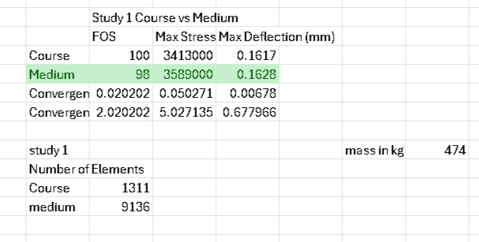

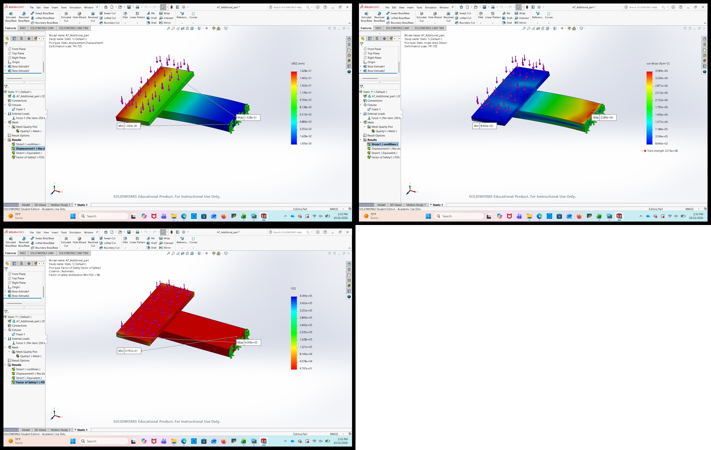

.jpg)

study 2

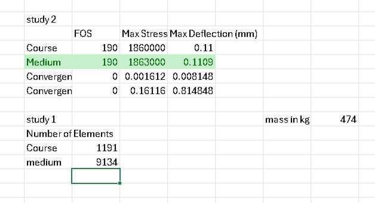

.jpg)

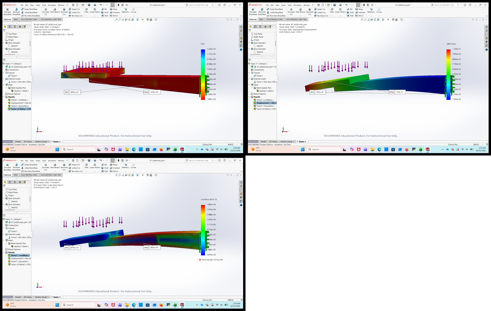

