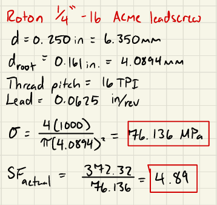
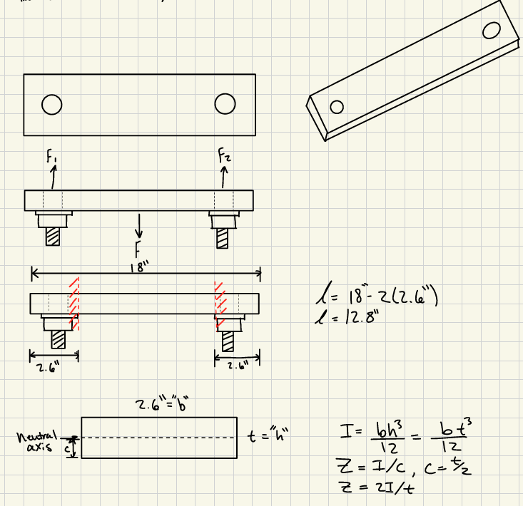
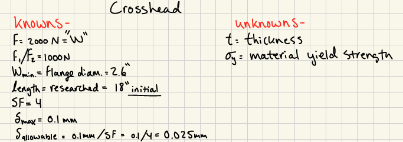
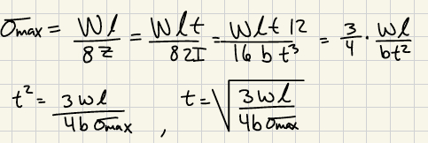
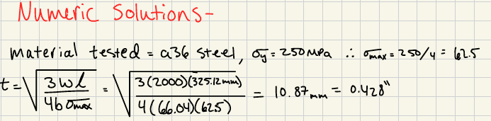
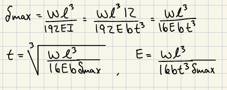
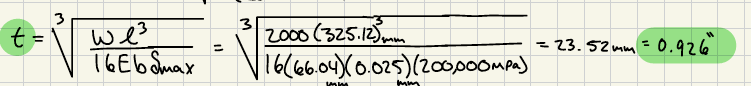
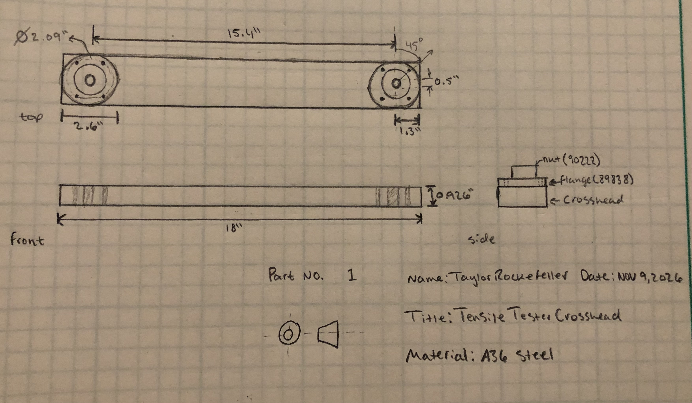
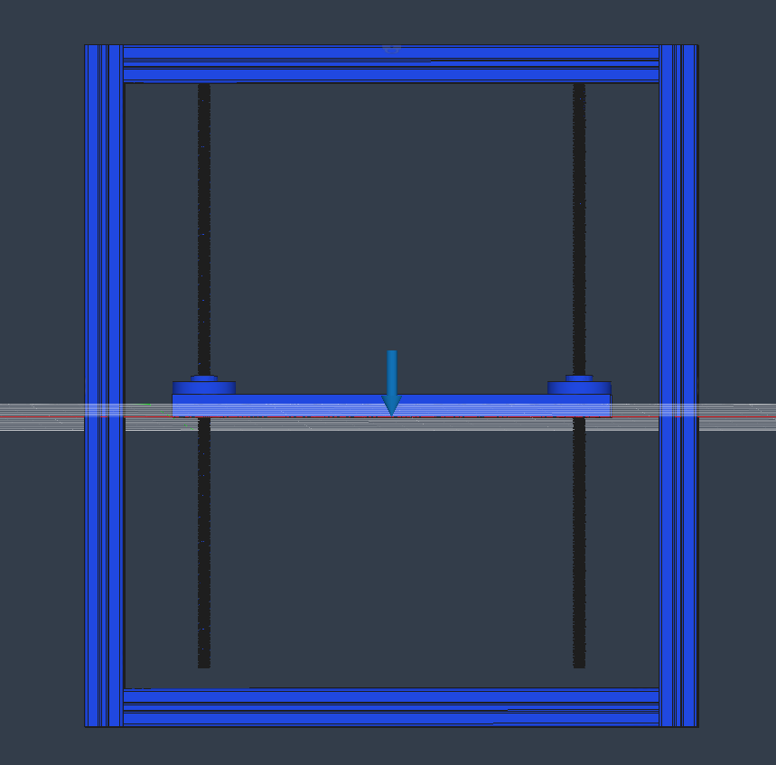
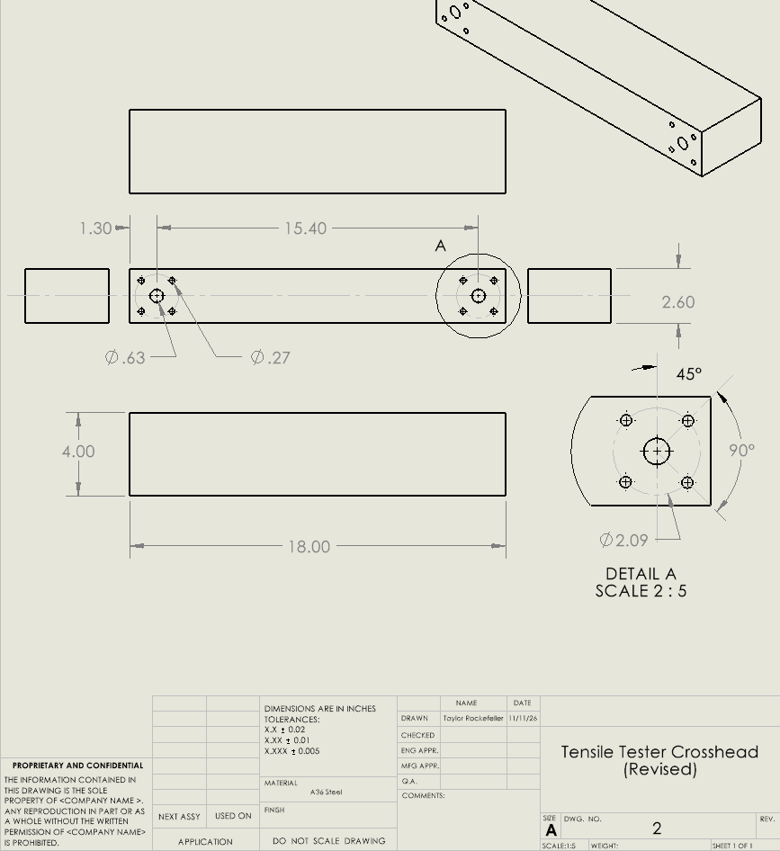

# A10 – Lead Screw Translating System

## Objective

.png)

.png)

.png)

.png)

.png)

## Leadscrew Diameter (Kadin Bittner)

Minimum Diameter-

.png)

.png)

.png)

.png)

Rotational Speed Range-

.png)

.png)

.png)

.png)

Max Torque-

.png)

.png)

.png)

.png)

Leadscrew Selection-

.png)

## Nut and Flange Selection (Kadin Bittner)

.png)

## Crosshead Design (Taylor Rockefeller)

Beam Stress Analysis-

.png)

Beam Deflection Analysis-

.png)

Multiview Sketch-

## Tabulating Costs (Taylor Rockefeller)

| Item Number | Quantity | Name | Cost($)/Item | Cost($) | Purchase Link |
| :---: | :---: | :---: | :---: | :---: | :---: | 
| 1 | 2 | Lead Screw | 18.20 | 36.40 | [Lead Screw](https://www.roton.com/product/acme-steel-screw-right-59284/) |
| 2 | 2 | Nut | 23.57 | 47.14 | [Nut](https://www.roton.com/product/acme-bronze-threaded-mount-nut-right-90222/) |
| 3 | 2 | Flange | 49.63 | 99.26 | [Flange](https://www.roton.com/product/flange-steel-flange-89838/) |
|  |  |  | Total Cost: | 182.80 |  |

## Parametric Modeling (Kadin Bittner)

Crosshead-

.png)

.png)

.png)

.png)

.png)

.png)

.png)

.png)

Assembly-

.png)

.png)

## Lessons Learned (Taylor Rockefeller)

Throughout the project, there have been many opportunities to utilize newly learned formulas to develop relationships between the desired load on the tensile tester and the dimensional/material requirements of the components to make the system functional and safe. After completing the initial lead screw diametrical requirement, a lead screw was selected to further evaluate. Though the lead screw met the first requirement, it failed further evaluation and an enlarged lead screw was required to maintain the safety factor of the system. Furthermore, the crosshead was evaluated to maintain the correct safety factor but in testing, the crosshead's thickness needed to be increased substantially.  

## 2157 Portion

## FEA (Kadin Bittner)

Model Setup-

Results to Report-

.png)

.png)

.png)

Optimization Pass #1-

Crosshead thickness was increased to 2 inches.

.png)

.png)

.png)

Optimization Pass #2-

Crosshead thickness was increased to 4 inches.

.png)

.png)

.png)

## Multiview Drawing (Taylor Rockefeller)

Crosshead Drawing-

Crosshead drawing seen below is available in this link for download. 

