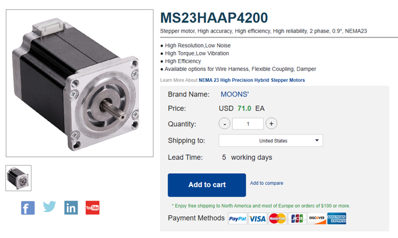
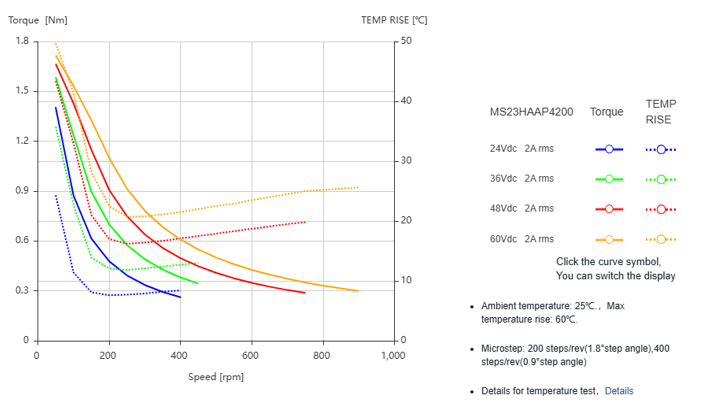
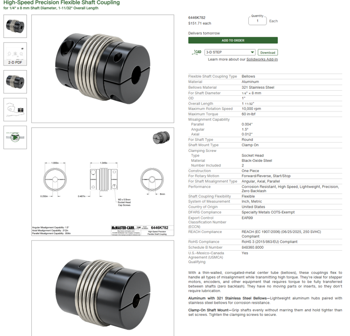
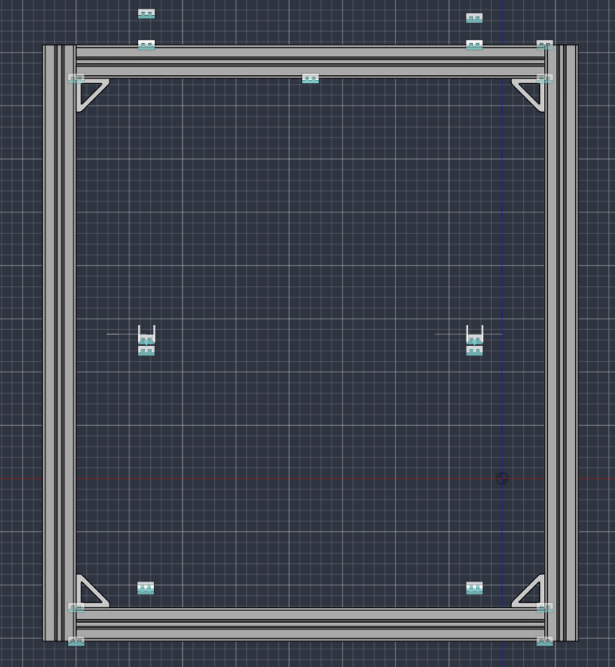
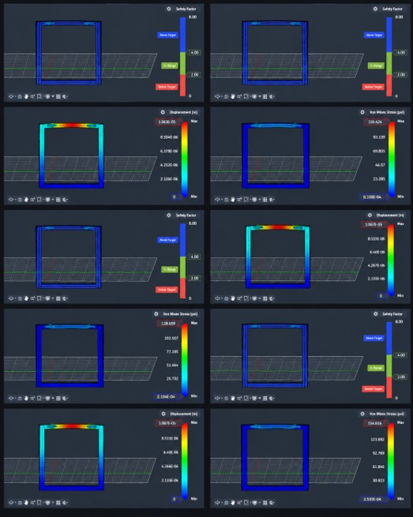
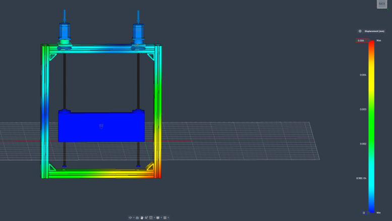
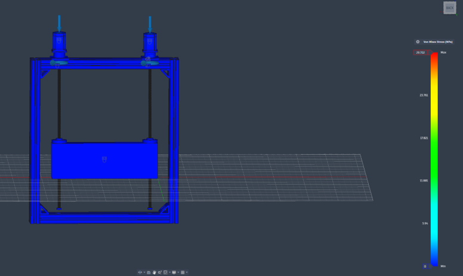
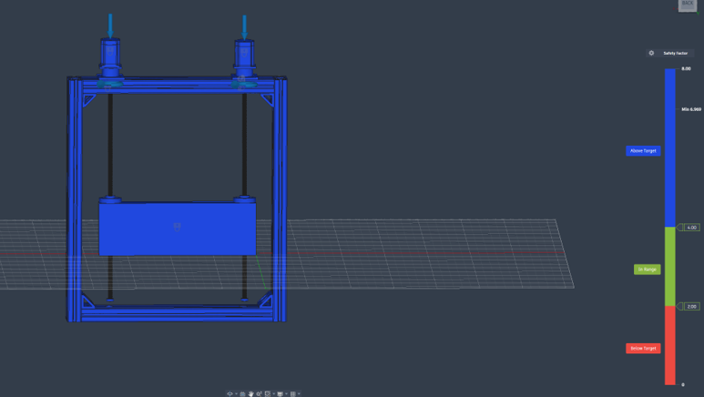

# A11 – Motor Selection

## Objective

.png)

.png)

.png)

.png)

.png)

.png)

.png)

.png)

## Motor Selection and Attachment:

### Motor Selection-

#### Motor

#### Speed Torque Curve

### Motor Mount-

#### Knowns/Unknowns

#### FBD

#### Equations

#### Numeric Solution

### Coupler-

#### Knowns/Unknowns

.png)

#### FBD

.png)

#### Equations

.png)

#### Numeric Solution/Coupler Selection

.png)

## Frame Design:

### Frame Connector Selections-

#### Knowns/Unknowns

.png)

#### FBD

.png)

#### Equations

.png)

#### Numeric Solution and Connector Selection

.png)

### Upper Beam FEA-

#### Model Setup

#### Meshing and Verification

#### Results

Maximum von Mises stress and location

Maximum vertical deflection at the grip line

Factor of Safety (based on chosen material yield)

Brief discussion of load path and any observed twisting/warping tendencies

#### Optimization Pass

### Vertical Frame Component FEA-

#### Model Setup

#### Meshing and Verification

#### Results

Maximum von Mises stress and location

Maximum vertical deflection at the grip line

Factor of Safety (based on chosen material yield)

Brief discussion of load path and any observed twisting/warping tendencies

#### Optimization Pass

## Floating Bearing Mount:

### Dimension and Loaction Justification-

### Functional Tolerances-

## Bill of Materials/ Labor Cost:

| Item Number | Quantity | Name | Cost($)/Item | Cost($) | Purchase Link |
| :---: | :---: | :---: | :---: | :---: | :---: | 
| 1 | 2 | Lead Screw | 18.20 | 36.40 | [Lead Screw](https://www.roton.com/product/acme-steel-screw-right-59284/) |
| 2 | 2 | Nut | 23.57 | 47.14 | [Nut](https://www.roton.com/product/acme-bronze-threaded-mount-nut-right-90222/) |
| 3 | 2 | Flange | 49.63 | 99.26 | [Flange](https://www.roton.com/product/flange-steel-flange-89838/) |
| 4 | 4 | Guesset | 11.23 | 44.92 | [Gusset](http://8020.net/40-4334.html) |
| 5 | 2 | Bearing | 26.50 | 53.00 | [Bearing](https://www.traceparts.com/en/product/motion-industries-radialdeep-groove-ball-bearing-6082rsh?CatalogPath=TRACEPARTS:TP01002001001002&Product=90-06092022-035185) |
| 6 | 4 | Frame Member | 82.10/meter | 228.62 | [Frame Member](https://8020.net/40-4080.html) |
| 7 | 2 | Motor | 71.00 | 142.00 | [Motor](http://www.moonsindustries.com/p/nema-23-high-precision-hybrid-stepper-motors/ms23haap4200-000004611110015320) |
| 8 | 2 | Coupler | 151.71 | 303.42 | [Coupler](http://www.mcmaster.com/6446K782) |
|  |  |  | Total Cost: | 954.76 |  |

| Person | Hours Worked | Cost($)/Hour | Cost($) | 
| :---: | :---: | :---: | :---: | 
| Taylor Rockefeller | X | 35 | 35*X | 36.40 |
| Kadin Bittner | Y | 35 | 35*Y |
|  |  | Total Cost: | 182.80 |

Total Cost of Project: $XXX

## Lessons Learned:

## 2157 Portion:

### Designed Components-

#### Crosshead

#### Motor Mount

#### Floating Bearing Mount

### Assembly-

### Bill of Materials-

| Item Number | Quantity | Name | Cost($)/Item | Cost($) | Purchase Link |
| :---: | :---: | :---: | :---: | :---: | :---: | 
| 1 | 2 | Lead Screw | 18.20 | 36.40 | [Lead Screw](https://www.roton.com/product/acme-steel-screw-right-59284/) |
| 2 | 2 | Nut | 23.57 | 47.14 | [Nut](https://www.roton.com/product/acme-bronze-threaded-mount-nut-right-90222/) |
| 3 | 2 | Flange | 49.63 | 99.26 | [Flange](https://www.roton.com/product/flange-steel-flange-89838/) |
| 4 | 4 | Guesset | 11.23 | 44.92 | [Gusset](http://8020.net/40-4334.html) |
| 5 | 2 | Bearing | 26.50 | 53.00 | [Bearing](https://www.traceparts.com/en/product/motion-industries-radialdeep-groove-ball-bearing-6082rsh?CatalogPath=TRACEPARTS:TP01002001001002&Product=90-06092022-035185) |
| 6 | 4 | Frame Member | 82.10/meter | 228.62 | [Frame Member](https://8020.net/40-4080.html) |
| 7 | 2 | Motor | 71.00 | 142.00 | [Motor](http://www.moonsindustries.com/p/nema-23-high-precision-hybrid-stepper-motors/ms23haap4200-000004611110015320) |
| 8 | 2 | Coupler | 151.71 | 303.42 | [Coupler](http://www.mcmaster.com/6446K782) |
|  |  |  | Total Cost: | 954.76 |  |

| Person | Hours Worked | Cost($)/Hour | Cost($) | 
| :---: | :---: | :---: | :---: | 
| Taylor Rockefeller | X | 35 | 35*X | 36.40 |
| Kadin Bittner | Y | 35 | 35*Y |
|  |  | Total Cost: | 182.80 |

Total Cost of Project: $XXX

## Resources

### Tensile Tester Design References

- [Design, Manufacturing, and Testing of an Open-Source Universal Testing Machine – TU Wien (2024)](https://repositum.tuwien.at/bitstream/20.500.12708/200949/1/Demmel%20Stella%20-%202024%20-%20Design%20manufacturing%20and%20testing%20of%20an%20open-source...pdf)
  - Reference for tensile tester design, mechanical components, and testing methods.

- [Low-Cost Universal Tensile Testing Machine – Hackaday](https://hackaday.io/project/192166-low-cost-universal-tensile-testing-machine)
  - Reference for developing an affordable tensile testing system.

- [FreeLoader – Creative Machines Lab](https://www.creativemachineslab.com/freeloader.html)
  - Reference for the mechanical arrangement of an open-source tensile tester.

 ### Frame/ Components

 - [Metric Profiles for T slot Framing - grainger](https://www.google.com/url?q=https://www.grainger.com/category/material-handling/structural-framing-systems/t-slot-framing-systems/profiles-for-t-slot-framing/metric-profiles-for-t-slot-framing?attrs%3DRelative%2BProfile%2BWeight%257CHeavy~~Series%257C40%2BSeries%26filters%3Dattrs&sa=D&source=editors&ust=1794952091817665&usg=AOvVaw2PWtiulz9v1kR32-zk-ETn)
   - Reference for various frame profiles.

- [Connectors for T slot Framing - grainger](https://www.google.com/url?q=https://www.grainger.com/category/material-handling/structural-framing-systems/t-slot-framing-systems/connectors-for-t-slot-framing?categoryIndex%3D3&sa=D&source=editors&ust=1794952091817806&usg=AOvVaw3UXMMvnxyfN7ayY0QMiQSY)
    - Reference for multiple T slot frame connector options.
 
- [Load Cell - dwyeromega](https://www.google.com/url?q=https://assets.dwyeromega.com/spec/DS-LC103B.pdf&sa=D&source=editors&ust=1794952091817902&usg=AOvVaw1Rnaub4fOdLtiBKVNsDh6B)
    - Reference for load cell data sheet.
 
- [Lead Screw and Nut/Flange - McMaster](https://www.google.com/url?q=https://www.mcmaster.com/products/acme-lead-screws/precision-lead-screws-and-nuts-1~/precision-acme-lead-screws-and-nuts-6/nut-type~externally-threaded/nut-type~flange/material~bronze-1/&sa=D&source=editors&ust=1794952091818054&usg=AOvVaw1W57GNAnq3MwQkERIMCFuA)
    - Reference for McMaster catalog of lead screws and nuts/flanges.
 
- [Lead Screw - Roton](https://www.google.com/url?q=https://www.roton.com/products/acme-lead-screws-nuts/engineering-data/?utm_source%3Dchatgpt.com&sa=D&source=editors&ust=1794952091818169&usg=AOvVaw0kI2oWCPY0Ikd0dJ_n5mO3)
  - Reference for Roton lead screw catalog.

 ### Engineering Theory 

 - [Column Buckling - Mechanicalc](https://www.google.com/url?q=https://mechanicalc.com/reference/column-buckling&sa=D&source=editors&ust=1794952091818303&usg=AOvVaw0Vx8LXXlq9TvZojPPf21bP)
     - Reference for column buckling calculations and end conditions.

 ### Reading

 - [DC Motor Calculations - Youtube](https://www.google.com/url?q=https://www.youtube.com/watch?v%3DhgW1fH08cVc&sa=D&source=editors&ust=1794952091812595&usg=AOvVaw06hVVFbBV_OH6KEWlZaPEq)

     - Reference for DC motor calculations for motor selection.

